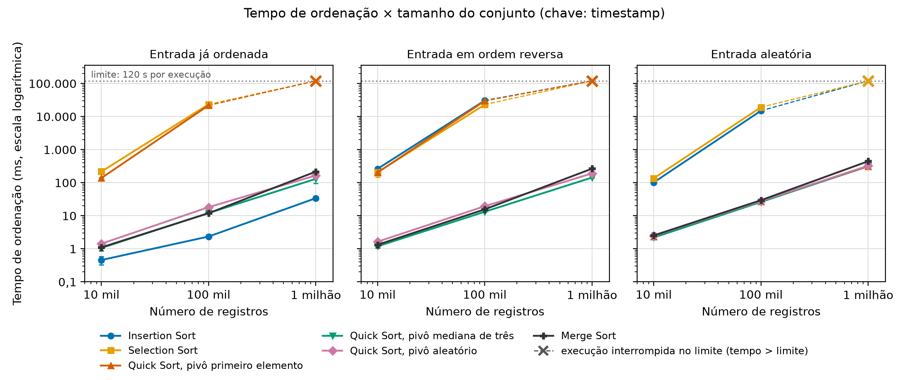
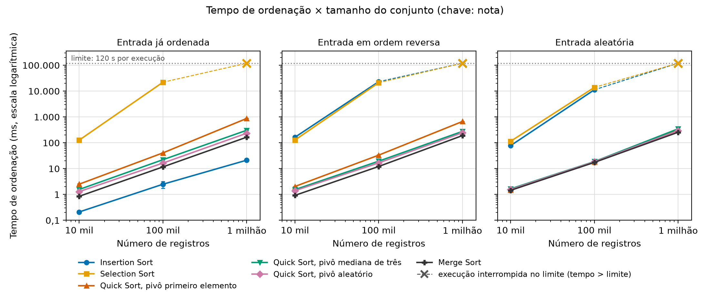
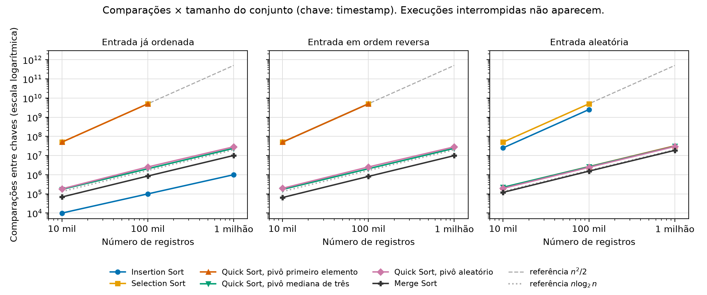
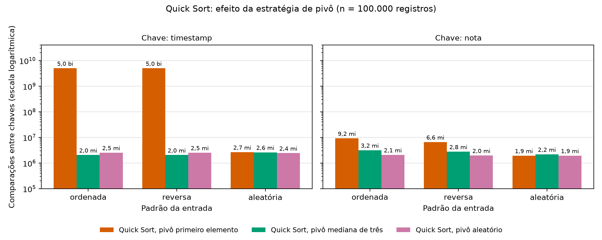

# Trabalho 2: Análise de Algoritmos de Ordenação

Comparação experimental de seis variantes de algoritmos de ordenação, implementados do zero em Java, sobre
**1 milhão de avaliações reais do MovieLens**, com medição de tempo, comparações e movimentações em três
padrões de entrada (ordenada, reversa e aleatória) e três tamanhos (10 mil, 100 mil e 1 milhão de registros).

Disciplina: Estrutura de Dados (ECO, Engenharia de Computação, IFC São Bento do Sul), Prof. Lucas Dominguez Cordeiro.

## Integrantes

- Henrique Balassa Avancini
- Laura Veiga Mondin
- Saulo Santos Resende

## Dataset

**MovieLens 25M** (GroupLens, Universidade de Minnesota): 25.000.095 avaliações de filmes, no arquivo `ratings.csv`
com as colunas `userId,movieId,rating,timestamp`.

- **Amostra:** sorteamos, com semente fixa (2026), **1.000.000 de avaliações reais**. A amostra é gravada em
  ordem aleatória, então os 10.000 e os 100.000 primeiros registros também são amostras aleatórias. Os três
  tamanhos são subconjuntos do mesmo arquivo, **sem replicação de dados**.
- **Chaves de ordenação:** `timestamp` (instante da avaliação, em segundos; quase não tem valores repetidos:
  973.187 distintos em 1 milhão) e `nota` (0,5 a 5,0, só 10 valores distintos, ou seja, muitas chaves repetidas).
  As duas se comportam de forma bem diferente, o que enriquece a análise, principalmente a do Quick Sort.
- **Licença e arquivo:** os termos de uso do MovieLens permitem pesquisa e não tratam de redistribuição. Por isso
  **o dataset não está neste repositório**: o script `dados/preparar_dados.py` baixa e prepara a amostra.
- **Citação:** F. M. Harper e J. A. Konstan. *The MovieLens Datasets: History and Context*. ACM TiiS 5(4), 2015.

## Algoritmos (todos implementados pela equipe)

| Algoritmo | Arquivo | Melhor caso | Caso médio | Pior caso | Observações |
|---|---|---|---|---|---|
| Insertion Sort | `InsertionSort.java` | O(n) | O(n²) | O(n²) | estável; se adapta à entrada |
| Selection Sort | `SelectionSort.java` | O(n²) | O(n²) | O(n²) | sempre n(n-1)/2 comparações; poucas trocas |
| Quick Sort | `QuickSort.java` | O(n log n) | O(n log n) | O(n²) | 3 estratégias de pivô; particionamento de Hoare |
| Merge Sort | `MergeSort.java` | O(n log n) | O(n log n) | O(n log n) | estável; memória extra O(n) |

**Quick Sort, estratégia do pivô** (escolha que decide o desempenho):
- *primeiro elemento*: simples, mas com entrada ordenada ou reversa o pivô é sempre o menor (ou o maior), a divisão
  fica 1 contra n-1 e o custo vira O(n²);
- *mediana de três* (primeiro, meio e último): divide ao meio em entradas ordenadas e reversas;
- *aleatório*: sorteio com semente fixa (2026); nenhum padrão de entrada é sempre ruim.

Detalhes de implementação: o particionamento de Hoare divide bem vetores com muitas chaves repetidas (a chave `nota`
tem só 10 valores; o de Lomuto degeneraria). A recursão é feita só na menor das duas partes, e a maior vira um
laço, o que mantém a profundidade abaixo de log₂ n e evita estouro de pilha.

**Por que o Merge Sort como segundo algoritmo eficiente:** é O(n log n) em todos os casos, é estável, conta
comparações da mesma forma que os demais (o Radix Sort, por exemplo, não faz comparações entre chaves) e a sua
recursão tem profundidade log₂ n. O custo é a memória extra de um vetor auxiliar.

## Estrutura do repositório

```
src/ordenacao/   código Java (algoritmos, carregador, benchmark e testes)
dados/           script de download e amostragem (o dataset não é versionado)
scripts/         geração dos gráficos e das tabelas
resultados/      graficos/ (PNG) e tabelas/ (resultados.csv, ambiente.txt, tabelas.md, tabelas.tex)
artigo/          artigo técnico e slides, em PDF
```

## Como executar

Requisitos: **Java 17 ou superior** (testado com a versão indicada abaixo) e **Python 3** com `pandas` e `matplotlib`
(`pip install pandas matplotlib`). Todos os comandos são executados na pasta raiz do projeto.

**1. Baixar e preparar o dataset** (baixa cerca de 250 MB e grava `dados/amostra.csv`):
```
python dados/preparar_dados.py
```
Se o download falhar por problema de certificado de rede, baixe `ml-25m.zip` pelo navegador
(https://files.grouplens.org/datasets/movielens/ml-25m.zip), salve em `dados/` e rode o mesmo comando.

**2. Compilar:**
```
javac -encoding UTF-8 -d out src/ordenacao/*.java
```

**3. Testar a correção** (108.000 casos, inclusive vetores vazios, com chaves repetidas e verificação de estabilidade):
```
java -cp out ordenacao.TesteOrdenadores
```

**4. Teste rápido de um tamanho** (opcional; o último argumento é `todos`, `rapidos` ou `seguros`):
```
java -cp out ordenacao.Principal dados/amostra.csv 100000
```

**5. Benchmark completo** (leva de 30 a 90 minutos; não use o computador durante a execução):
```
java -cp out ordenacao.Benchmark
```
Opções: `--tamanhos=10000,100000,1000000`, `--reps=5`, `--limite=120` (tempo máximo de uma execução, em segundos),
`--limite-rep=20` (execuções acima disso não são repetidas), `--saida=resultados/tabelas`.
O resultado vai para `resultados/tabelas/resultados.csv` e o ambiente para `resultados/tabelas/ambiente.txt`.

**6. Gerar gráficos e tabelas:**
```
python scripts/gerar_graficos.py
```

## Metodologia

- **Medição:** apenas a ordenação. A cópia da entrada, a geração dos padrões, a leitura do arquivo e a verificação
  ficam fora do tempo medido. A coleta de lixo é pedida antes de cada execução.
- **Aquecimento:** cada algoritmo é executado antes em um vetor de 20.000 registros, para a JVM compilar o código.
- **Mesma entrada:** todos os algoritmos recebem cópias idênticas da mesma entrada, com semente fixa.
- **Correção:** toda execução é conferida contra a referência ordenada (o `Arrays.sort` do Java é usado só aqui, para
  validar, e para preparar as entradas ordenada e reversa, fora da medição; ele nunca é um dos algoritmos avaliados).
- **Repetições:** 5 execuções por experimento, com média e desvio-padrão amostral. Quando uma execução passa de
  20 s, ela não é repetida (inviável); essas células aparecem marcadas com `*`.
- **Métricas:** tempo de execução (ms), número de comparações entre chaves e número de movimentações (escritas no
  vetor; uma troca conta como 2). Toda comparação passa por um único método, então a contagem é exata. Memória não foi medida.
- **Limite de tempo (o critério dos algoritmos quadráticos):** uma execução que passa de **120 s** é interrompida e
  registrada como `INTERROMPIDO`. Isso é uma **medição** (a execução durou pelo menos 120 s), não uma estimativa.
  Para o mesmo algoritmo, chave e padrão, os tamanhos maiores ficam `NAO_EXECUTADO`.

### Ambiente de testes

| Item | Valor |
|---|---|
| Processador | AMD64 Family 25 Model 80 Stepping 0, AuthenticAMD |
| Processadores lógicos | 16 |
| Memória física | 15774 MB |
| Memória máxima da JVM | 3944 MB |
| Sistema operacional | Windows 11 10.0 (amd64) |
| Java | 26.0.2 - Java HotSpot(TM) 64-Bit Server VM (Oracle Corporation) |
| Data da execução | 2026-11-22T18:53:34 |

Todos os testes foram executados na mesma máquina.

## Resultados

Os dados completos estão em `resultados/tabelas/resultados.csv`, e todas as tabelas em `resultados/tabelas/tabelas.md`.

### Tempo × tamanho





### Comparações × tamanho, com as curvas teóricas



### Efeito do pivô no Quick Sort



### Tabelas principais (chave `timestamp`)

**Tempo (ms), n = 100.000**

| Algoritmo | Ordenado | Reverso | Aleatório |
|---|---:|---:|---:|
| Insertion Sort | 2,35 ± 0,30 | 30.615* | 14.988 ± 96,4 |
| Selection Sort | 23.448* | 23.007* | 19.109 ± 958,4 |
| Quick Sort (pivô: primeiro) | 21.787* | 29.835* | 26,6 ± 0,71 |
| Quick Sort (pivô: mediana de três) | 12,1 ± 0,05 | 13,2 ± 0,32 | 26,1 ± 0,49 |
| Quick Sort (pivô: aleatório) | 18,2 ± 0,29 | 19,5 ± 0,96 | 27,9 ± 0,54 |
| Merge Sort | 11,9 ± 0,36 | 15,6 ± 0,21 | 29,5 ± 0,69 |

_Média ± desvio-padrão de 5 repetições. * = execução única (acima de 20 s não se repete). > 120 s = execução interrompida no limite de tempo._

**Tempo (ms), n = 1.000.000**

| Algoritmo | Ordenado | Reverso | Aleatório |
|---|---:|---:|---:|
| Insertion Sort | 33,9 ± 0,30 | > 120 s | > 120 s |
| Selection Sort | > 120 s | > 120 s | > 120 s |
| Quick Sort (pivô: primeiro) | > 120 s | > 120 s | 311,6 ± 2,46 |
| Quick Sort (pivô: mediana de três) | 130,8 ± 36,1 | 142,9 ± 2,36 | 319,8 ± 2,10 |
| Quick Sort (pivô: aleatório) | 164,9 ± 1,00 | 190,7 ± 1,52 | 324,8 ± 0,75 |
| Merge Sort | 216,2 ± 7,05 | 265,3 ± 1,34 | 444,8 ± 6,66 |

_Média ± desvio-padrão de 5 repetições. * = execução única (acima de 20 s não se repete). > 120 s = execução interrompida no limite de tempo._

**Comparações entre chaves, n = 100.000**

| Algoritmo | Ordenado | Reverso | Aleatório |
|---|---:|---:|---:|
| Insertion Sort | 99.999 | 4.999.949.982 | 2.509.842.849 |
| Selection Sort | 4.999.950.000 | 4.999.950.000 | 4.999.950.000 |
| Quick Sort (pivô: primeiro) | 4.999.887.741 | 4.979.847.622 | 2.657.217 |
| Quick Sort (pivô: mediana de três) | 2.047.510 | 2.047.529 | 2.613.307 |
| Quick Sort (pivô: aleatório) | 2.540.017 | 2.534.509 | 2.434.960 |
| Merge Sort | 853.904 | 815.271 | 1.536.417 |

_— = execução interrompida (contagem incompleta, não comparável)._

## Discussão

1. **O pivô decide o Quick Sort.** Com 100 mil registros em `timestamp` ordenado, o pivô "primeiro elemento" fez
   cerca de 5,0 bilhões de comparações e levou 21,8 s; a mediana de três fez 2,0 milhões e levou 12 ms. Em entrada
   aleatória, os três pivôs empatam (de 26 a 28 ms).
2. **Chaves repetidas amenizam o pior caso.** Na chave `nota`, o pivô "primeiro" fez só 9,2 milhões de comparações
   no caso ordenado (100 mil), porque o particionamento de Hoare divide bem blocos de chaves iguais. Mesmo assim,
   foi cerca de 3 vezes mais lento que a mediana de três com 1 milhão (874 contra 305 ms).
3. **Os algoritmos quadráticos são inviáveis em 1 milhão de registros.** Em 100 mil (chave `timestamp`), o Selection
   Sort levou de 19 a 23 s em qualquer padrão (exatamente n(n-1)/2 = 4.999.950.000 comparações) e o Insertion Sort
   de 15 a 31 s nos casos aleatório e reverso. Em 1 milhão, passaram do limite de 120 s e foram interrompidos
   (exceto o Insertion Sort em entrada ordenada).
4. **O Insertion Sort é o melhor em entrada já ordenada.** Com 1 milhão de registros, fez 999.999 comparações e levou
   34 ms, menos que o Quick Sort de pivô mediana de três (131 ms) e que o Merge Sort (216 ms): é o melhor caso O(n).
5. **Merge Sort: previsível, mas com custo de movimentação.** Em entrada aleatória (`timestamp`, 1 milhão), fez
   menos comparações (18,7 milhões) que o Quick Sort (cerca de 30 milhões), mas levou mais tempo (445 ms contra
   cerca de 320 ms), porque faz mais movimentações (29,4 milhões contra 9 a 11 milhões) e usa memória
   extra. Na chave `nota`, o Merge Sort ficou à frente (256 ms contra 293 a 347 ms).
6. **Crescimento coerente com a teoria.** O Merge Sort passou de 29,5 ms para 444,8 ms de 100 mil para 1 milhão
   (fator 15; o esperado para n log n é cerca de 12). O Insertion Sort aleatório em 100 mil fez
   2.509.842.849 comparações, praticamente n²/4.

### Tratamento do limite dos algoritmos quadráticos

Em 100 mil registros todos os algoritmos terminaram. Em **1 milhão de registros**, foram interrompidos no limite de
120 s: o Selection Sort em todos os casos; o Insertion Sort nos padrões reverso e aleatório; e o Quick Sort de pivô
"primeiro elemento" na chave `timestamp` ordenada e reversa. O Insertion Sort em entrada ordenada, e os demais, terminaram.

Estimativa por extrapolação (**não é medição**): o Selection Sort com 1 milhão precisa de exatamente
n(n-1)/2 ≈ 5 × 10¹¹ comparações; nos 120 s ele chegou a entre 6,6 e 29,3 bilhões. Se esse ritmo se mantivesse, a
execução completa levaria algo entre cerca de 34 minutos e 2,5 horas.

**Observação sobre uma medição inválida:** a execução do Insertion Sort, chave `nota`, entrada aleatória, 1 milhão,
registrou 2.167 s até a interrupção (o limite era 120 s). O computador provavelmente suspendeu ou travou durante
essa execução. Ela deve ser lida apenas como "interrompido, passou de 120 s"; o tempo e a contagem registrados
não são válidos e não são usados nos gráficos nem nas tabelas.

### Limitações

- Uma única máquina e um único dataset.
- A memória não foi medida.
- Os tempos de 10 mil registros são curtos e sofrem influência do aquecimento da JVM (por exemplo, o Selection Sort
  ordenado mediu mais que o aleatório); as conclusões se apoiam nas comparações e nos tamanhos maiores.
- Execuções acima de 20 s não foram repetidas, e as de 1 milhão dos quadráticos foram interrompidas.

## Uso de Inteligência Artificial

Foi usada a ferramenta de IA generativa **Claude (Anthropic)** como apoio à programação (escrita e revisão do
código), à pesquisa de fontes e à revisão do texto. Todos os integrantes estudaram o código, os resultados e as
conclusões, e conseguem explicá-los e justificá-los.

## Referências

- CORMEN, T. H.; LEISERSON, C. E.; RIVEST, R. L.; STEIN, C. *Algoritmos: teoria e prática*. 3. ed. Rio de Janeiro:
  Elsevier, 2012.
- ZIVIANI, N.; BOTELHO, F. C. *Projeto de algoritmos: com implementações em Java e C++*. São Paulo: Cengage Learning, 2007.
- HARPER, F. M.; KONSTAN, J. A. The MovieLens Datasets: History and Context. *ACM Transactions on Interactive
  Intelligent Systems*, v. 5, n. 4, 2015.
- GroupLens Research. MovieLens 25M Dataset. https://grouplens.org/datasets/movielens/25m/
